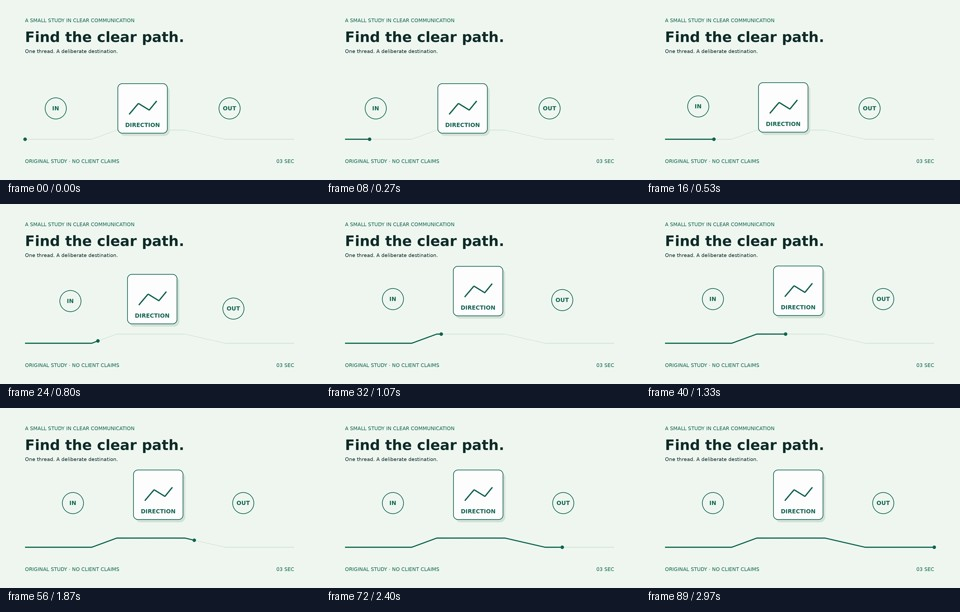
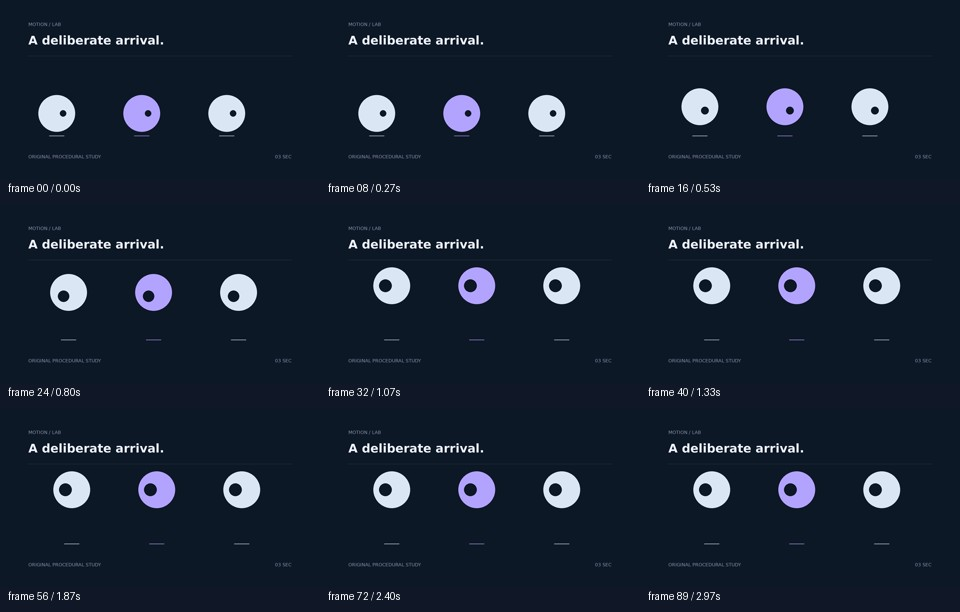

# Motion Training

## Watch the senior-skill experiment videos



**[Open/download the new video with music, effects and draft voice-over](examples/senior-improved.mp4)** ·
[Open/download its baseline](examples/senior-baseline.mp4)

[Download the updated complete motion-design skill ZIP](motion-design-skill.zip) ·
[Original supplied senior-motion-designer ZIP](skills/senior-motion-designer-original.zip)

These examples use your existing senior skill as their baseline. The technical improvement
in this pair is effect synchronization; no aesthetic or professional voice-quality claim
is made. The report at `runtime/report.html` contains all completed local experiments.
The committed ZIP is a fixed verified snapshot; the running controller keeps newer
snapshots in `runtime/motion-design-skill.zip` and `runtime/archives/`.

A working, original motion-design experiment controller. It generates frame-indexed
animations, renders H.264 MP4s, measures the decoded video, tests controlled alternatives,
checks transfers, and rebuilds a verified skill ZIP after **every completed round**.
It runs as a separate resumable process, with no conversation or paid model dependency.

This repository was initially empty. No pre-existing skill or ZIP was replaced.
The renderer uses Pillow/NumPy and FFmpeg, chosen because they are available in this
environment and provide reproducible exact frames without browser installation.
There are no reference videos, downloaded templates or external visual examples.

## See an actual rendered example



[Play/download the quintic candidate MP4](examples/arrival.mp4) ·
[Play/download its linear baseline MP4](examples/baseline.mp4) ·
[Download the verified round-three skill ZIP](skills/motion-design-skill-round-000003.zip)

These are real outputs of the first experiment: 1920×1080, 90 frames, exactly three
seconds. The contact sheet was extracted from the encoded video. This example and
the committed ZIP are fixed snapshots; `runtime/motion-design-skill.zip` contains
the latest completed round in a running environment. See [example details](examples/README.md).

## Install and verify

Requires Linux, Python 3.11+, FFmpeg/FFprobe with libx264, and the DejaVu Sans fonts.
On Debian/Ubuntu, the system packages are `ffmpeg fonts-dejavu-core python3-venv`.

```bash
cd /workspace/MotionTraining
python3 -m venv .venv
.venv/bin/python -m pip install -r requirements.txt
.venv/bin/python -m unittest discover -s tests -v
.venv/bin/python -m motionlab run --rounds 3
.venv/bin/python -m motionlab verify
.venv/bin/python -m motionlab status
```

Use the existing checkout in this isolated task; do not create a worktree unless requested.
The tests render real 640×360 videos for speed. The normal controller renders **1920×1080,
30 FPS, exactly 3 seconds / 90 frames**. The controller test run renders baseline and
alternatives, held-out transfers when warranted, and fixed technical benchmarks.

## Operate

### User-supplied senior motion design skill

The active baseline is now the supplied **senior-motion-designer** skill, not the
bootstrap skill created when the repository was empty. All 105 supplied files,
including SKILL.md, library modules, Remotion helpers, data and audio tools, are kept
byte for byte in the current ZIP. The import is explicitly recorded as a baseline
change, not a successful motion experiment. Earlier bootstrap records are retained.

`motionlab import-skill /path/to/skill.zip` imports a skill while the controller is
stopped, preserves its original archive under runtime/imports/, and creates a new
verified snapshot. The additive `training/AUTONOMOUS.md` explains the user's research
authorization separately from the unchanged client-film workflow.

Research now cycles through sound effects, visuals, materials, smoothness, originality,
music, voice-over, timing, transitions, typography, rendering libraries, sound-picture
sync and mixing. Bright palettes, an asymmetric hierarchy and a purposeful thread
apply the supplied design principles. Named arrive/depart/move curves are implemented
from the supplied easing control points. Every new seed changes the composition.

Audio-enabled studies reuse the supplied `music_make.py` and `sfx_synth.py` to compose
original music and synthesize effects, plus local eSpeak draft speech. MP4s contain an
actual 48 kHz AAC soundtrack. The voice is explicitly a robotic draft, not a claim of
professional performance. Full mixed audio is decoded and checked for finite samples,
duration and clipping; precise effect sync is measured on a decoded stem. Mixed-track
audibility, musical taste and voice intelligibility remain unevaluated. FFmpeg applies
the declared loudness target, but a separate compliance measurement is not yet claimed.

Technical audio-sync gains can be promoted only after two transfer checks. Visual,
material, music, voice and originality hypotheses remain **experimental** without a
capable independent evaluator; successful rendering alone does not prove improvement.
The existing visual-evaluator command adapter is optional. No paid API is assumed.
The supersampled raster candidate tests a distinct rendering pipeline; existing
Remotion helpers remain intact, but there is no claim that this lab rendered through
Remotion or After Effects. The private online library artifact is not republished.

For continuous creation → rendering → analysis → controlled improvement:

```bash
.venv/bin/python -m motionlab --config continuous.json start --continuous
.venv/bin/python -m motionlab --config continuous.json status
.venv/bin/python -m motionlab --config continuous.json stop
```

Continuous mode has no round limit. It retains explicit limits of 24 hours per
invocation and 2 GiB cumulative storage, and requires a running host. Each new seed
varies object sizes, positions and displacements, with identical layouts within each
controlled comparison. The normal three-round command remains useful for verification.

```bash
# Foreground; run up to three additional rounds within the configured budgets.
.venv/bin/python -m motionlab run

# Detached process with a log; confirm process_active with status after starting.
.venv/bin/python -m motionlab start --rounds 100

# Finish the active render and stop at a safe checkpoint.
.venv/bin/python -m motionlab stop

# Resume an interrupted round, reuse verified candidates, then complete up to ten rounds.
.venv/bin/python -m motionlab resume --rounds 10

.venv/bin/python -m motionlab status
.venv/bin/python -m motionlab report
.venv/bin/python -m motionlab verify

# Restore the newest valid immutable archive if the current ZIP was corrupted.
.venv/bin/python -m motionlab recover
```

`--rounds` is an additional completed-round limit per invocation, not a promise of nonstop
operation. `max_runtime_seconds` and `max_disk_mb` remain enforced. `run` and `resume`
clear the previous STOP request. The controller lock prevents simultaneous writers.
A detached process only continues while its host is running. Cloud snapshots retain
files, not live processes. For persistent operation, run this on a persistent Linux host
under the supplied systemd service, with explicitly chosen budgets. No daemon is silently
installed and no unlimited paid API usage is assumed.

Open `runtime/report.html` from a downloaded copy of the runtime directory to compare
playable videos. A report served from a persistent host also works. There is no public
web deployment or localhost preview involved in cloud onboarding.

## Resource and experiment configuration

Copy `config.json` to a separate file and use `--config /absolute/path/config.json`
**before** the subcommand. `output` is resolved relative to that configuration file.
Use a separate output directory when changing resolution, renderer code or benchmark
definitions, so old and new measurements are not silently mixed.

- `rounds`: default additional rounds per invocation (3).
- `candidates`: up to four alternate values per round (2 initially).
- `max_runtime_seconds`: wall-clock budget (1800 initially).
- `render_timeout_seconds`: timeout per rendering/decoding operation (90).
- `max_disk_mb`: cumulative artifact limit with 64 MiB reserved for checkpoints (2048).
- `threads`: FFmpeg threads (2; capped at 8).
- `retries`: bounded deterministic retry after an interrupted/failed render (1).
- `regression_every`: broader fixed technical suite interval (10).
- `minimum_relative_gain`: both decoded-video and trajectory jerk must improve by
  this fraction (0.15), with at least 24 stable hold frames and no new drift/clipping.
- `seed`, `background`, even `width`/`height`: deterministic rendering controls.
- `evaluation_weights`: the seven requested visual criteria, configurable and summing
  to one. These are preferences, **not objective evidence** of design quality.
- `visual_evaluator_command`: optional independent evaluator argument list; null by default.
- `visual_evaluator_timeout_seconds`: evaluator invocation budget.

The initial structured scheduler covers easing, travel timing, sequencing and transient
overshoot across original orbit, typography, card, reveal, morph and wave studies.
It loads accepted defaults from the newest ZIP, so actual generation uses learned
technical settings. Candidates change one variable at a time. Winners are selected
on a declared technical metric, then tested on two seeded held-out scene families.
This is a bounded procedural research system, not an unrestricted creative AI: new
families/hypotheses require extending the generator/scheduler and validating that
infrastructure separately. Paid-model generation is not implemented or implied.

## Evidence and classification

Every output is probed for dimensions, duration, FPS and 90 frames. Every frame is
decoded with FFmpeg's error checks. Evaluation extracts nine actual decoded frames,
measures visible object centroids and temporal pixel changes, checks renderer layout
bounds, and records exact trajectory metrics as supplementary evidence. No video is
accepted merely because its source compiled or a process existed.

- **Validated:** a limited technical finding passed primary, two transfer checks,
  and any due regression. It changes technical defaults and increments skill version.
- **Experimental:** a primary technical gain did not pass both transfer checks.
- **Rejected:** the tested candidate failed the declared threshold/regression. Aesthetic
  hypotheses remain unverified when no visual evaluator exists.
- **Unevaluated:** subjective criteria without a capable independent visual evaluator.

Lower centroid jerk may reflect silhouette changes, and slower motion can trivially
reduce jerk. The system therefore requires trajectory agreement, explicit scope and
readable holds; it does **not** equate those findings with professional visual quality.
Bounds checks detect viewport overflow, not all overlaps, optical legibility or artistic
intent. Text legibility, hierarchy, originality and polish remain subjective limitations.
The fixed technical suite is repeatable and separate from winner selection. Seeded
holdouts are not private hidden benchmarks. No fabricated subjective scores are stored.

Every ten rounds (and in round one), the candidate defaults are compared against the
best retained defaults across the fixed cards/mask/wave suite. More than 10% decoded
jerk degradation rejects the change. This is a technical regression guard, not a
substitute for independent visual assessment or a statistically proven aesthetic claim.

## Optional independent visual evaluator

Configure an executable argument list, e.g. `["/path/to/evaluator"]`. The controller
appends `REQUEST_JSON RESPONSE_JSON`. The request supplies shuffled blind identifiers,
video paths, seven criteria and a 0–100 scale; it hides baseline/candidate labels.
The evaluator should actually inspect the videos. Configure credentials privately on
the host; never embed secrets in configuration, command arguments or archived source.

The response schema is:

```json
{
  "assessments": {
    "IDENTIFIER_FROM_REQUEST": {
      "evaluator_id": "operator-verified-independent-evaluator",
      "scores": {
        "motion_smoothness": 75,
        "timing_easing": 75,
        "visual_hierarchy": 75,
        "composition_spacing": 75,
        "creativity_originality": 75,
        "transitions": 75,
        "professional_polish": 75
      },
      "uncertainty": 0.25,
      "critique": "A specific observation based on the rendered video."
    }
  }
}
```

These example numbers illustrate the schema; they are not experiment assessments.
Every requested identifier must be returned. Invalid output, timeout or failure is
recorded explicitly. The operator must establish evaluator capability and independence.
Visual scores alone never promote a permanent rule. This adapter does not make any
API calls itself; model/cost accounting is zero for the built-in system. If a configured
external evaluator uses a paid API, its operator must enforce its budget separately.

## Persistent outputs and recovery

```
runtime/
  motion-design-skill.zip       # primary authoritative skill
  motion-design-skill.zip.sha256
  archives/                    # immutable ZIP and SHA256 after every completed round
  skill/                       # readable mirror, ZIP remains authoritative
  experiments.sqlite           # rounds, candidates, events; WAL + FULL sync
  rounds/000001/
    source/                    # complete original renderer/controller + runtime config
    baseline/                  # runnable source, scene, MP4, motion data, evaluation, frames
    candidate-0/
    transfer-0-baseline/
    record.json                # prepared experiment journal
    zip-receipt.json            # resulting ZIP path and SHA256
  checkpoint.json
  controller.json
  controller.log               # detached invocation log
  status.json
  report.html
  recovery/                    # preserved corrupted/current archive during rollback
  history.git/                 # local Git history of skill and original implementation
  history-content/             # controller-owned Git work tree, not the user checkout
```

ZIP snapshots contain the reusable skill, interpolation code, defaults, experiment index,
concise records, knowledge, changelog, benchmark/regression summaries and a manifest of
per-file SHA256 hashes. Videos, frames and larger datasets stay outside the ZIP. The skill
round increments for every completed round; semantic version increments only on validated
knowledge/functionality changes. Current and versioned archives also have whole-file SHA256.

Publication writes and verifies a temporary archive, retains the previous archive,
creates the new immutable round snapshot, then atomically replaces the current ZIP.
On restart, ZIP history reconciles SQLite if interruption occurred between ZIP publication
and database commit. Valid cached renders are reused. Damaged current ZIPs are preserved
and replaced from the newest verified archive; the system refuses a destructive reset
if all archives are invalid. Incomplete rounds stay incomplete, with no false ZIP claim.

To replay a candidate against its preserved implementation:

```bash
cd /workspace/MotionTraining/runtime/rounds/000001/source
PYTHONPATH="$PWD" /workspace/MotionTraining/.venv/bin/python ../baseline/source.py
```

The replay is written beside the candidate under `replay/`. Keep the complete runtime
directory for recoverability; a skill ZIP alone contains learning records, not the videos.
The controller commits the skill and original implementation into an isolated local
Git history after every round, with immutable `round-000001` style tags. This never
stages unrelated files in the user's checkout or pushes to a remote. Inspect with
`git --git-dir=runtime/history.git log --oneline` or
`git --git-dir=runtime/history.git show round-000001:motion-design-skill/SKILL.md`.
Git history is recovered from verified archives after interrupted publication.
Use the checkout's own Git separately for source changes (`git add` / `git commit`
when desired). Preserve runtime/history.git along with ZIPs and the database.
