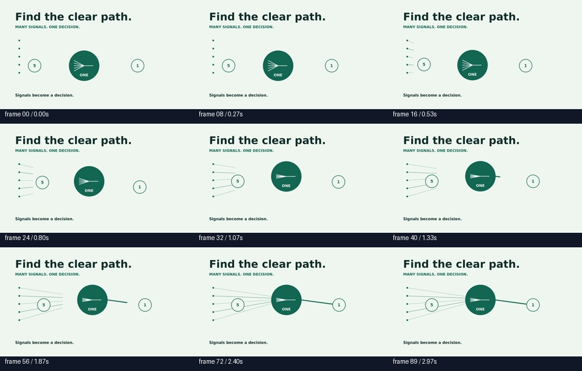
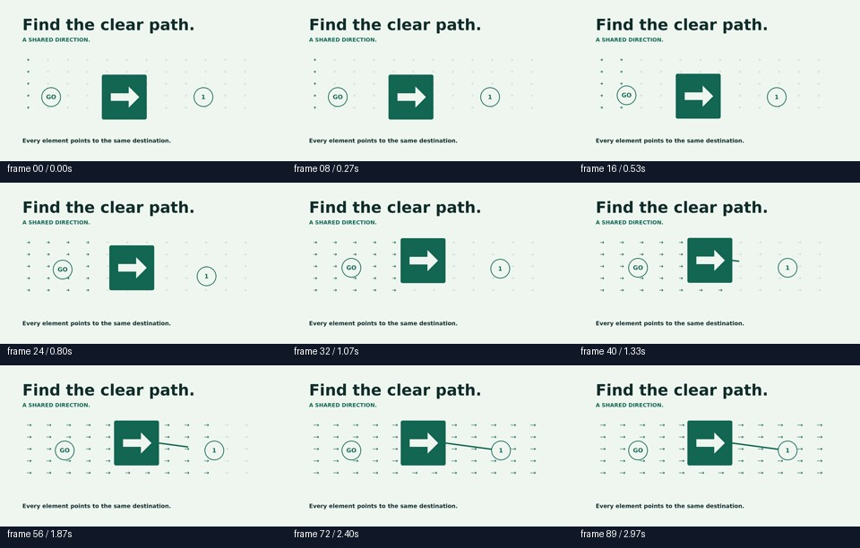

# Composition studies

These compare visibly distinct explanations with the same timing, palette and audio. All three MP4s passed full-frame decode, audio integrity, viewport bounds and final-hold checks. They are design prototypes, not independently validated improvements.

- [Previous layout](routing.mp4)
- [Five signals consolidate into one decision](signal_merge.mp4)
- [A shared directional field](direction_field.mp4)

If the player is unavailable, choose **View raw** to play or download.

Creator review: the signal study has a clearer cause and consequence than the earlier disconnected footer route. The direction field is visibly different but the repeated arrows may add unnecessary clutter. Both still use a short generic message and need stronger storytelling and better voice performance. This review is not independent evaluation.
