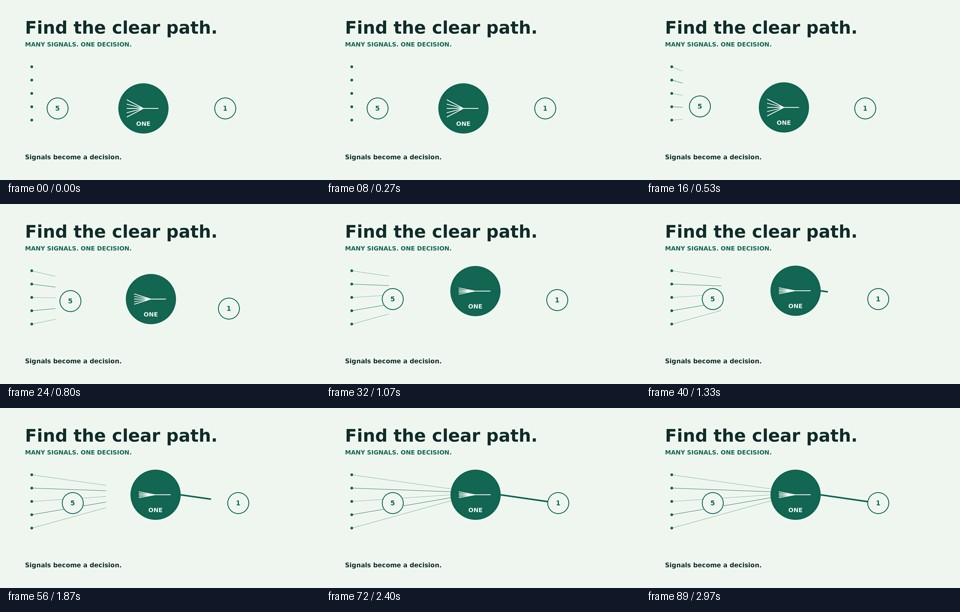
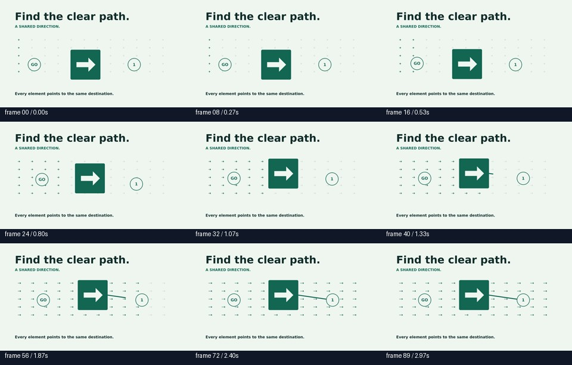

# Latest published composition comparison

Snapshot from round 138. These are later repetitions of the existing composition studies, not newly validated artistic improvements.

- [Baseline](baseline.mp4)
- [Signal merge](signal_merge.mp4)
- [Direction field](direction_field.mp4)

Choose **View raw** if GitHub does not show a player.

